<p align="center">
  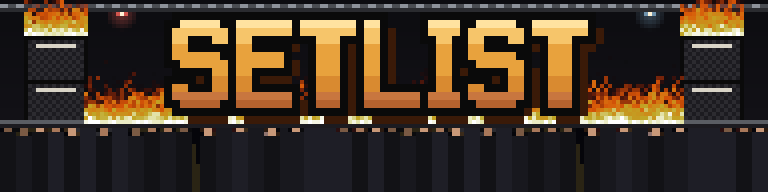
</p>

<p align="center">
  <a href="https://cyphomat.github.io/setlist/"></a>
  
  
  
  <a href="LICENSE"></a>
</p>

<p align="center">
  <b>Ein Trainingsplaner für eine Person.</b><br>
  Zweimal Kraft, zweimal Rad pro Woche. Die Woche ist eine Setlist.
</p>

<p align="center">
  <sub>100% vibe coded. Nutzung auf eigene Gefahr. Featurewünsche gerne gesehen.</sub>
</p>

<p align="center">
  <b>Deutsch</b> · <a href="README.en.md">English</a> · <a href="CHANGELOG.md">Changelog</a>
</p>

<h3 align="center">Loslegen → <a href="https://cyphomat.github.io/setlist/">cyphomat.github.io/setlist</a></h3>

<p align="center">
  <b>1</b> · <a href="https://cyphomat.github.io/setlist/">App öffnen</a> und <b>Lokal starten</b>. Kein Konto, keine Anmeldung; das Programm ist in einer Minute angelegt.<br>
  <b>2</b> · Auf den Home-Bildschirm legen (iPhone: Safari → Teilen → <i>Zum Home-Bildschirm</i>). Dann läuft sie offline, und Safari räumt deine Daten nicht weg.<br>
  <b>3</b> · Ab und zu unter <i>Backstage → App → Daten</i> eine Sicherung herunterladen. Damit ziehst du auch aufs nächste Gerät um.
</p>

<p align="center">
  <sub>Deine Trainingsdaten bleiben in diesem Browser (<a href="#daten">mehr dazu</a>). Lieber in einem eigenen privaten GitHub-Repo, auf mehreren Geräten, oder den Code selbst in der Hand? <a href="#-selbst-einrichten">Selbst einrichten</a>.</sub>
</p>

> **Zur Sprache.** Die App gibt es auf Deutsch und Englisch — umschaltbar unter **Tour → ⚙ Backstage → App**. Zweisprachig sind die ganze Oberfläche, die Ansage samt Tageswort, Meilensteine, Minierfolge, Aufnäher und Fehlermeldungen. Deutsch bleiben nur die *Übungsinhalte* — Erklärungen, Cues, typische Fehler, Bewegungsstandards — sowie die mitgelieferten Sprüche, die Jam-Bewegungen und die Rad-Begründungen. Das ist Fachtext, der inhaltlich übersetzt werden muss statt Wort für Wort. In deinen Daten steht das Tageswort immer deutsch, damit „Ansage gegen Gefühl“ in beiden Sprachen gleich zählt.

---

##  So sieht es aus

<table>
<tr>
<td width="33%">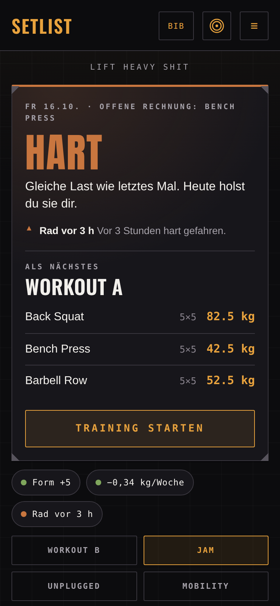</td>
<td width="33%">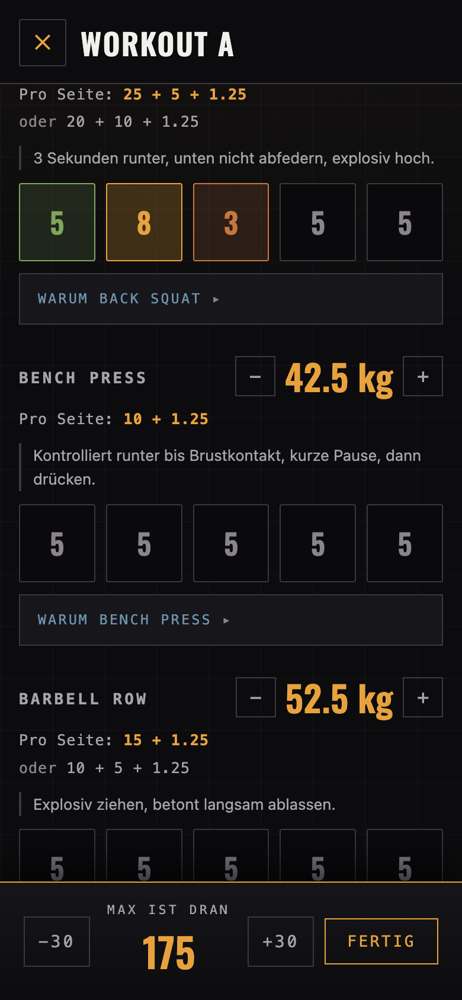</td>
<td width="33%">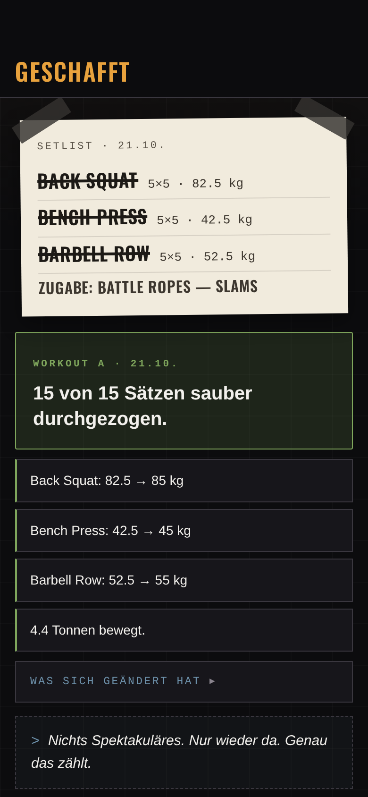</td>
</tr>
<tr>
<td align="center"><b>Das Plakat</b><br><sub>Ein Wort für den Tag, darunter nur Ausnahmen</sub></td>
<td align="center"><b>Im Studio</b><br><sub>Scheiben, Kadenz, Sätze über dem Ziel</sub></td>
<td align="center"><b>Danach</b><br><sub>Erst der Erfolg, dann der Bericht</sub></td>
</tr>
</table>

**Auf dem Mac wird daraus eine Übersicht** — Kalender, Wochenlast, Bestwerte und Verlaufskurven nebeneinander statt untereinander:

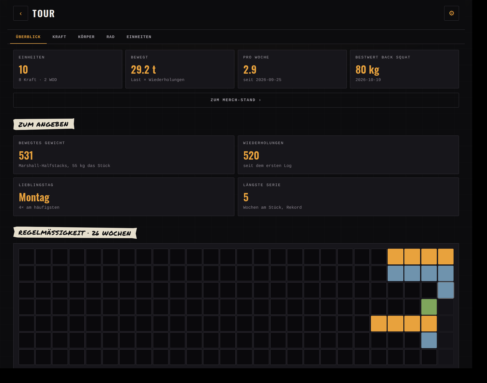

**Und so richtest du es ein** — die App fragt, statt dich eine JSON-Datei schreiben zu lassen:

<table>
<tr>
<td width="33%">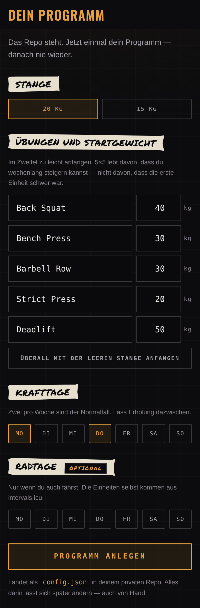</td>
<td width="33%">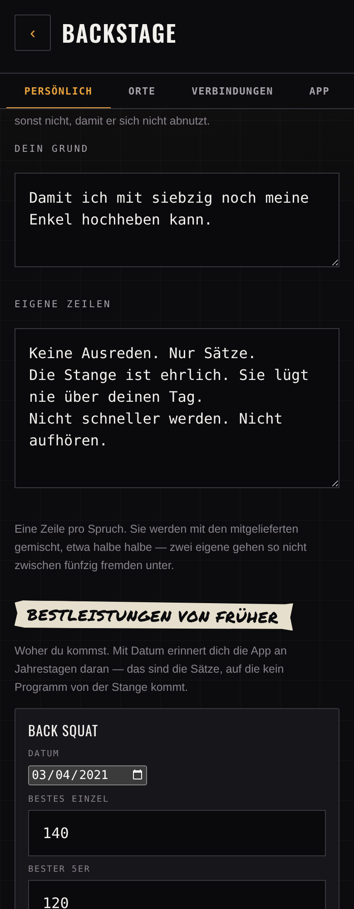</td>
<td width="33%">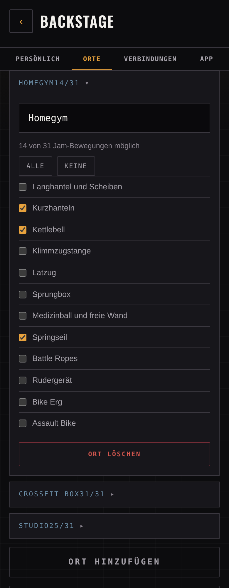</td>
</tr>
<tr>
<td align="center"><b>Ersteinrichtung</b><br><sub>Stange, Übungen, Trainingstage</sub></td>
<td align="center"><b>Deine Stimme</b><br><sub>Grund, eigene Zeilen, alte Bestwerte</sub></td>
<td align="center"><b>Orte und Geräte</b><br><sub>Was steht wo</sub></td>
</tr>
</table>

**Und das sagt sie dir über deine Kraft** — nicht nur wie viel, sondern wo sie schief steht:

<table>
<tr>
<td width="25%">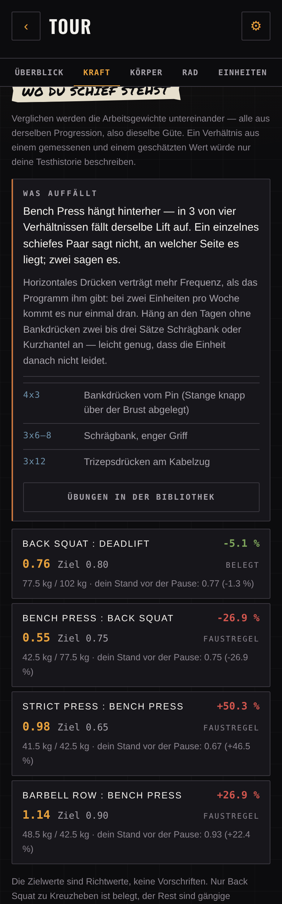</td>
<td width="25%">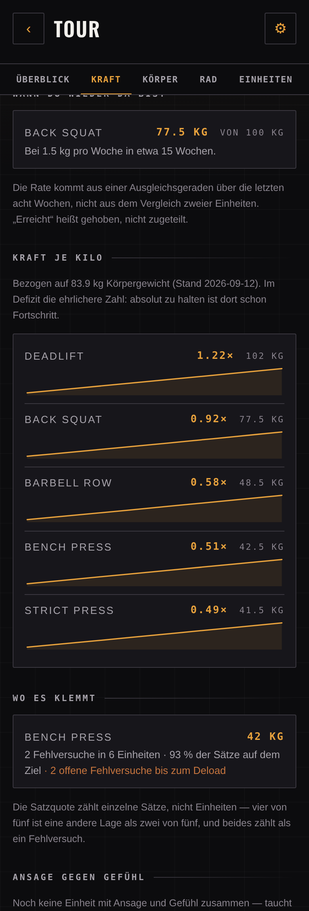</td>
<td width="25%">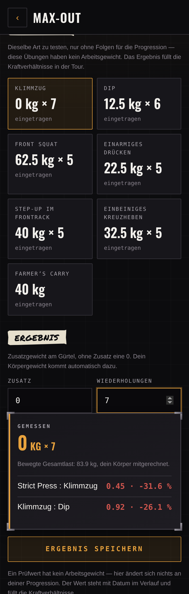</td>
<td width="25%">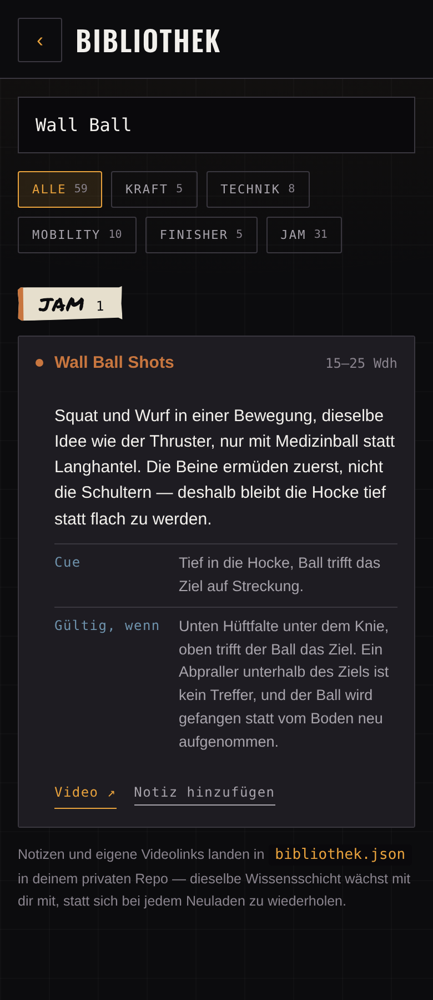</td>
</tr>
<tr>
<td align="center"><b>Wo du schief stehst</b><br><sub>Derselbe Lift in mehreren Paaren = die Ursache</sub></td>
<td align="center"><b>Wann du wieder da bist</b><br><sub>Hochrechnung, Kraft je Kilo, Plateaus</sub></td>
<td align="center"><b>Prüfwerte</b><br><sub>Im Max-Out gemessen statt getippt</sub></td>
<td align="center"><b>Gültig, wenn</b><br><sub>Wann die Wiederholung zählt</sub></td>
</tr>
</table>

**Und ein bisschen Bühne** — Rang, Monats-Tour mit Endgegner, Aufnäher, Schallplatten und Tourshirts, alles aus deinen Einheiten:

<p align="center">
  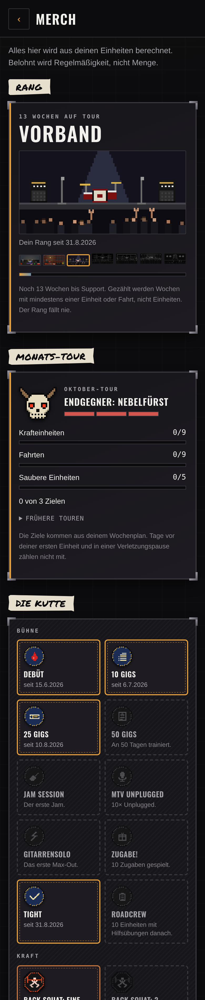
</p>

<sub>Echte Bildschirme mit Beispieldaten, aufgenommen über <code>tools/shot.html</code> und <code>tools/shots.mjs</code>. Keine Mockups.</sub>

<p align="center">
  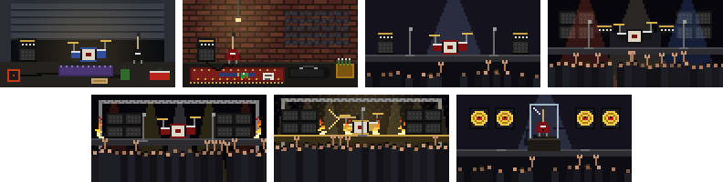
  <br><sub>Sieben Ränge, von der Garage bis zur Hall of Fame.</sub>
</p>

<p align="center">
  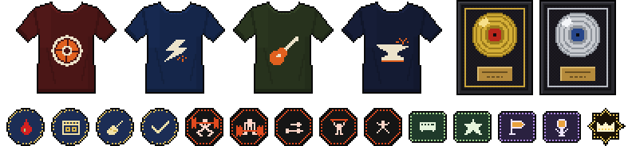
  <br><sub>Tourshirts, Gold und Platin, Aufnäher. Alles eigene Pixel-Art aus <code>tools/pixel.mjs</code>, keine fremden Grafiken.</sub>
</p>

---

## Was sie dir sagt

Der Unterschied zu einem Logbuch: sie hat eine Meinung zum heutigen Tag — aus Daten, nicht aus dem Bauch.

- **Die Ansage** liest Trainingspause, offene Fehlversuche, laufende Serie und Form vom Rad und entscheidet zwischen `TECHNIK`, `SOLIDE`, `HART` und `SCHWER` — und fragt nach der Einheit, wie sich das wirklich angefühlt hat. Die Ansage bleibt damit überprüfbar statt behauptet.
- **HRV und Schlaf gehen vor.** Fällt die HRV deutlich unter den eigenen Schnitt der letzten Tage oder war die Nacht zu kurz, sagt die App TECHNIK an — auch wenn Trainingsplan oder offene Fehlversuche eigentlich etwas anderes verlangen würden. Beides sieht etwas, das reine Trainingslast nicht erfasst.
- **Interferenz-Warnung**, wenn eine harte Fahrt weniger als vier Stunden her ist — die letzten Sätze werden zäh, das Maximalkraftniveau bleibt unberührt.
- **Meilensteine** kennen die alten Bestleistungen samt Datum:

  > **Aus deiner Geschichte** — Gestern vor 5 Jahren: 140 kg Back Squat. Heute stehst du bei 65 kg — nicht weil du weniger kannst, sondern weil du wieder anfängst.

- **Minierfolge** stehen nach jeder Einheit ganz oben. Nicht der Bericht, sondern das Geschaffte.
- **Die Stimme** mischt eigene Zeilen mit 52 mitgelieferten, etwa halbe halbe. Eintragbar unter **Tour → ⚙ Backstage → Persönlich** — dort steht auch *dein Grund*, der nur an den harten Tagen erscheint.

## Wie es zusammenhängt

```
Zwift ──▶ Strava ──▶ intervals.icu ◀──▶ Setlist ◀──▶ setlist-data (privat)
                            │                              │
                       Fahrten, Form                  Kraft-Progression
```

Setlist besitzt die **Kraft**-Progression — zwei Systeme, die dasselbe Arbeitsgewicht berechnen, laufen unweigerlich auseinander. Das **Rad** läuft andersherum: es kommt automatisch über Zwift → Strava → intervals.icu, Setlist zeigt es nur als Hinweis und schreibt im Gegenzug jede Krafteinheit zurück, damit Fitness und Ermüdung in einer Kurve liegen statt in zwei getrennten Welten.

Der Rückweg wartet bewusst bis zum nächsten App-Start: die Apple Watch erkennt Krafttraining oft selbst über die Herzfrequenz und reicht es mit Verzögerung über Strava nach. Ein sofortiger Push käme dem meist zuvor und dieselbe Einheit stünde doppelt in Fitness und Ermüdung.

## Zweimal und zweimal

5×5 ist ursprünglich für drei Einheiten pro Woche gebaut. Bei höchstens zwei gilt dieselbe Mechanik, nur langsamer — die 60-%-Regel für den Wiedereinstieg hätte bei dieser Frequenz sechs bis neun Wochen unter Reizschwelle bedeutet, deshalb sind es 80 %.

|  | Übung 1 | Übung 2 | Übung 3 |
|---|---|---|---|
| **Workout A** | Back Squat 5×5 | Bench Press 5×5 | Barbell Row 5×5 |
| **Workout B** | Back Squat 5×5 | Strict Press 5×5 | Deadlift 1×5 |

Back Squat ist in beiden Workouts dabei und steigt darum doppelt so schnell.

---

##  Funktionen

### Kraft

| | |
|---|---|
| **5×5-Automat** | Steigerung, Fehlerzähler, Deload auf 90 % nach drei Fehlversuchen. |
| **Deload nach einer Pause** | Ab 14 Tagen ohne Krafteinheit schlägt die App beim Start einen Rückschritt vor: −10 %, ab 21 Tagen −20 %, ab 42 Tagen −30 %. Ein Tipp übernimmt, einer behält die alten Gewichte — nichts ändert sich ohne dich. Danach steigt jede erfolgreiche Einheit **doppelt**, bis das Gewicht vor der Pause wieder erreicht ist; ein Fehlversuch beendet die Abkürzung. Faustregeln, keine Messwerte. |
| **Plattenrechner** | Scheiben pro Seite. Nicht exakt ladbare Gewichte werden benannt statt gerundet. Darunter eine zweite Zeile mit derselben Last **nur aus 20/10/5/2,5/1,25** — die Reihe, die in jedem Studio komplett liegt. Wo keine 25er und 15er sind, lädt man eben `2×20` statt `25 + 15`. Sie erscheint nur, wenn sie etwas anderes sagt. |
| **Soundcheck** | Aufwärmsätze aus dem Arbeitsgewicht: leere Stange, dann 55 / 70 / 85 %. Jede Zeile abhakbar — angetippt durchgestrichen. |
| **Gewicht im Satz** | Anpassbar während der Einheit — das Log bildet ab, was wirklich passiert ist. |
| **Pausenuhr** | 90 s, nach Fehlversuch 180 s, im Lauf um ±30 s verstellbar. Endet mit Vibration und Ton, stoppt sich nach dem letzten Satz der Einheit selbst. |
| **Aftershow** | Hilfsübungen nach dem Hauptprogramm: Klimmzüge, Chin-ups, Dips, Liegestütze, Face Pulls, Curls, hängendes Beinheben. Je Satz die Wiederholungen, daneben, was beim letzten Mal ging. Ohne Steigerung, ohne Einfluss auf Gewichte und Tonnage. In der Tour steht je Übung der beste Satz. |
| **Bestwerte** | `Maximum` (nur aus Max-Out) gegen `Mindestens` (aus Arbeitssätzen, systematisch zu niedrig). |
| **Max-Out** | Krafttest mit e1RM. Dreht den A/B-Wechsel nicht. |
| **Wissen an der Stange** | Aufklappbar: Begründung, Cue, typischer Fehler, Brücke zum olympischen Heben. |
| **Mobility** | Fünf Übungen, einmal pro Kalenderwoche fällig — bei der ersten Einheit (Kraft oder Jam), ganz gleich welcher. Eigener Button, jederzeit unabhängig davon nutzbar. In der Einheit lässt sich „Mobility gemacht“ abhaken, in der Bibliothek trägt **Heute gemacht** einen eigenen kleinen Eintrag ein. Mobility zählt als Mobility, nicht als Training: keine Serie, keine Tonnage, keine Übertragung zu intervals.icu. Dreimal in einer Woche bringt den Aufnäher **Gelenkig**. |
| **Gefühl nach der Einheit** | Vier Stufen (Leicht/Normal/Hart/Extrem) auf dem Geschafft-Screen — macht die Ansage im Nachhinein überprüfbar. |
| **Injury Report** | Was gerade zwickt, mit deiner eigenen Behandlung. Zwei Arten: *wiederkehrend* (kommt und geht, wird nach der Einheit kurz abgefragt, kann ausheilen) und *strukturell* (bleibt, wird nicht abgefragt, sperrt dauerhaft). Übungen, die du sperrst, würfelt der Jam nicht, das Unplugged nimmt sie nicht, Technik und Mobility lassen sie weg. Grundübungen werden nur angemerkt, nie weggelassen — daran hängt die 5×5-Mechanik. Die App stellt keine Diagnose und schlägt keine Behandlung vor. |
| **Merch-Stand** | Ein bisschen Spiel, passend zur Bühne: eine **Kutte** mit Aufnähern (Plattenclub, 1000-lb-Club, Körpergewicht-Marken, Comeback, Serien, Roadcrew und Hangar 18 für die Aftershow … und fürs Rad: Tourbus-Kilometer, Stairway to Heaven, Highway Star, Doom für disziplinierte Grundlage, Open Air, Crossover-Wochen mit Kraft und Rad), **Gold und Platin** fürs bewegte Gewicht als gerahmte Auszeichnungen an der Studiowand, ein **Rang** von der Garagenband bis zur Hall of Fame und jedes Quartal ein **Tourshirt** als Pixel-Bandshirt: Stofffarbe und Emblem kommen aus dem Tournamen, vorne Siebdruck, hinten deine Trainingstage — zum Umdrehen. Nach der Einheit kommt die Setlist als Zettel mit Gaffa-Tape, auf Home steht ein Wochenregler, der nur bei erfülltem Plan **und** sauberen Sätzen auf elf geht. Belohnt wird Regelmäßigkeit, nie Menge: der Rang zählt Wochen statt Einheiten (Radwochen eingeschlossen), und eine eingetragene Verletzung **friert die Serie ein** statt sie reißen zu lassen. Alles aus den Logs berechnet, nichts gespeichert. |
| **Pixel-Bühne** | Jeder Aufnäher hat ein eigenes Pixelbild, auch jede Stufe einer Leiter: die Gigs wachsen vom Setlist-Zettel über Ticket, Plakat und Amp bis zum hochgehaltenen Feuerzeug, die Kilometer vom Fahrrad bis zur Weltkugel, und im Plattenclub steht jeder Lift als eigene Figur mit 1–4 Scheiben an der Stange. Die Form zeigt die Kategorie: Bühne rund, Kraft achteckig, Rad eckig, Comeback Wappen, Serie Stern. Jeder Rang hat seine Szene, von der Garage bis zur Hall of Fame, darunter die Tour mit allen Stationen. An Tagen mit **SCHWER** brennt hinter dem Wort ein kleines Pixelfeuer. Nach der Einheit sagt ein **Ansager** die großen Momente an: neuer Rang, neuer Aufnäher, wieder auf dem Stand vor der Pause, eine runde Marke wie „100 KG“, der Wochenregler auf elf, „FLAWLESS“. Es gibt höchstens eine Ansage je Einheit, und unter *Backstage → App* lässt sie sich abschalten. Mit „Bewegung reduzieren“ im System gibt es kein Feuer und keinen Sprung. Eigene Pixel-Art, keine fremden Grafiken. |
| **Monats-Tour** | Jeden Monat drei Ziele aus deinem eigenen Wochenplan: die geplanten Krafteinheiten, die geplanten Fahrten (ohne Rad: vier Tage Jam, Unplugged oder Mobility) und halb so viele saubere Einheiten. Am Ende wartet der **Endgegner** des Monats, vom Frostriesen im Januar bis zum Krampus im Dezember, mit einer Lebensleiste, die mit jedem erfüllten Ziel ein Drittel verliert. Tage vor der ersten Einheit und in einer Verletzungspause zählen nicht zum Soll. Fällt der Gegner, sagt der Ansager **TOUR KOMPLETT**; dazu Aufnäher für 1, 3, 6 und 12 besiegte Monate. Die Karte steht im Merch, die Zeile im Wochenkopf. |
| **Wochen-Soundcheck** | Sonntags für die laufende Woche, montags und dienstags noch für die vergangene: die Zahlen der Woche (Einheiten, Jams, Mobility, Fahrten, Tonnen, saubere Sätze), dazu „Lief gut“, „Hakt“ und drei Vorsätze. Er liegt als eigene Datei im Datenrepo (`soundcheck/JJJJ-Www.json`), ohne Netz in der Warteschlange. Die Vorsätze stehen danach im Wochenkopf, frühere Soundchecks in der Tour. Aufnäher für 4 und 12 Wochen in Folge. |
| **Flightcase-Look** | Karten mit Kantenschutz an den Ecken wie am Case, Überschriften als Gaffa-Streifen mit Edding-Schrift, das Tageswort in Anton. Beide Schriften liegen im Repo (`assets/fonts/`, Lizenzen daneben), es wird nichts von außen geladen. |
| **Ansage gegen Gefühl** | In der Tour: jede Einheit mit beiden Werten, dazu die Trefferquote — Ansage und gefühlte Schwere nebeneinander statt nur behauptet. |
| **Wo du schief stehst** | Zwölf Kraftverhältnisse gegen Richtwerte *und* gegen deinen eigenen Stand vor der Pause. Fällt derselbe Lift in mehreren Paaren auf, nennt die App ihn als Ursache und schlägt Zusatzarbeit vor — ein einzelnes schiefes Paar sagt nicht, an welcher Seite es liegt. Verglichen werden nur Werte gleicher Güte. |
| **Prüfwerte** | Klimmzug, Dip, Front Squat, einarmiges Drücken, Step-Up, einbeiniges Kreuzheben und Farmer's Carry — was das 5×5 nicht selbst erzeugt. Im Backstage eintragen oder **im Max-Out messen**; ein gemessener Test schlägt die Handeingabe und steht mit Datum im Verlauf. Damit kommen acht weitere Verhältnisse dazu, darunter ob dein Ziehen zu deinem Drücken passt. |
| **Wann du wieder da bist** | Hochrechnung je Übung aus deiner tatsächlichen Steigerungsrate bis zum Gewicht vor der Pause. „Erreicht" heißt gehoben, nicht zugeteilt. |
| **Kraft je Kilo** | Arbeitsgewicht geteilt durch Körpergewicht, mit Verlauf. Im Defizit die ehrlichere Zahl — dort ist Halten schon Fortschritt. |
| **Wo es klemmt** | Plateaus, bevor der Deload-Zähler sie meldet: wie lange ein Gewicht steht, Fehlversuche, und wie viele einzelne Sätze auf dem Ziel lagen. |
| **Nach 5×5** | Muss ein Lift zweimal ohne neues Hoch in den Deload, steckt er fest. Beim Start schlägt die App dann den klassischen nächsten Schritt vor: **5×5 → 3×5 → 3×3** (Kreuzheben 1×5 → 1×3), gleiches Gewicht, weiter steigern. Nur mit deiner Zustimmung, als Anpassung im Log und unter *Tour → Kraft* jederzeit zurückzunehmen. |

### Rad und Kondition

| | |
|---|---|
| **Radfahrten** | Fahrten, Stunden, Kilometer, Wochenlast über zwölf Wochen — aus intervals.icu. |
| **Trainingskalender** | 26 Wochen als Raster: Kraft bernstein, Jam grün, Rad stahlblau. |
| **Wochenlast gestapelt** | Kraft und Rad in einem Balken — die eine Kurve, wegen der beides zusammengehört. |
| **Fitness gegen Ermüdung** | Zwei Linien aus intervals.icu — die Fläche dazwischen *ist* die Form. |
| **Erholung (HRV/Schlaf)** | Aus intervals.icu, meist via HealthFit aus Apple Health. HRV nur relativ zur eigenen Basis der letzten Tage bewertet, nicht absolut. Fließt in die Ansage ein. |
| **Wattziele** | Aus der eFTP statt Prozentangaben. |
| **Unplugged** | Fünfzehn Minuten, nur Körpergewicht, im Zweifel leise. Feste Intervalle mit geführter Uhr statt Wiederholungszahlen — für den Morgen, an dem noch jemand schläft. Der Leise-Modus lässt alles Springende weg und gibt keinen Ton, nur Vibration. |
| **Jam** | Fünf Formate, 31 Übungen, Lasten aus dem aktuellen Stand. Nie zwei Langhantelteile. |
| **Skalierung** | Jede Übung nennt Alternativen. „Kann ich nicht" nimmt sie dauerhaft raus. |

### App

| | |
|---|---|
| **Offline** | Einheiten werden gepuffert. Tour und Radansicht zeigen den letzten Stand. |
| **Bildschirm bleibt an** | Während Einheit, Jam, Unplugged und Max-Out geht das Display nicht aus. Zum Abhaken muss nicht entsperrt werden. Danach gibt die App den Bildschirm wieder frei. |
| **Export als CSV** | *Backstage → App*: alle Einheiten als Tabelle für Excel, Numbers oder Sheets. Entsteht im Browser, geht an keinen Dienst; Text aus deinen Daten kommt nie als Formel an. |
| **Selbstaktualisierend** | Prüft die Version beim Start und lädt sich genau einmal neu. |
| **Sound und Vibration** | Ton bei Pausenende und Einheitsabschluss, zusätzlich zur Vibration — Ton respektiert den Stumm-Schalter, Vibration nicht. |
| **Hell und dunkel** | Umschalter System / Hell / Dunkel. Zwei echte Fassungen, keine Invertierung. |
| **Schriftgröße** | Normal / Groß / Sehr groß unter *Backstage → App*. Skaliert die ganze Oberfläche gleichmäßig, gilt nur auf diesem Gerät. |
| **Startseite als Plakat** | Oben ein Tageswort (TECHNIK, SOLIDE, HART, SCHWER), darunter nur, was heute etwas ändert — Pause, Verletzung, müde Form, Rad zu nah. Form, Schlaf, Gewicht und Rad stehen als kleine Instrumente darunter und klappen auf Antippen auf. Rechts eine Wochenkarte mit Regler und Serie und eine Gewichtsliste, über der die Reunion-Tour steht, bis sie geschafft ist. |
| **Tour mit Reitern** | Überblick, Kraft, Körper, Rad, Einheiten. Die Einstellungen liegen getrennt davon im **Backstage** (⚙ in der Tour): Persönlich, Orte, Verbindungen, App. |
| **Handy und Mac** | Ab 900 px zwei Spalten, in der Tour breitere Raster — dieselbe Reihenfolge, kein Umbau. |
| **Deutsch und Englisch** | Unter Backstage umschaltbar: Oberfläche, Ansage, Meilensteine, Minierfolge und Meldungen. Übungsinhalte und Sprüche bleiben deutsch. |

### Bibliothek

| | |
|---|---|
| **Alle Übungen an einem Ort** | Grundlifts, Technik, Mobility, Finisher und alle Jam-Bewegungen, durchsuchbar und nach Kategorie filterbar. |
| **Wann die Wiederholung zählt** | Zu 60 Übungen steht ein Bewegungsstandard als Prüfkriterium: nicht „tief in die Hocke", sondern „Hüftfalte unter der Kniescheibe, oben Hüfte und Knie ganz gestreckt". Auch im Jam, im Unplugged und in der laufenden Einheit. Dehnungen und Geräte auf Zeit bleiben bewusst ohne — dort gibt es keine gültige Wiederholung. |
| **Nach Kategorien gegliedert** | Jede Kategorie mit eigener Farbe und Anzahl; je Übung Name, Dosis und Cue, aufgeklappt Erklärung, Standard, Fehler und „Wenn es klemmt“. |
| **Übung des Tages** | Den ganzen Tag dieselbe, kompakt oben; „Ansehen“ klappt sie in der Liste auf, ↻ würfelt neu. Tritt beim Suchen und Filtern zurück. |
| **YouTube-Suchlink statt geratenem Video** | Ein einzelnes fest verdrahtetes Video könnte offline oder falsch sein. Per eigenem Link überschreibbar. |
| **Eigene Notizen** | Auf Wunsch über „Notiz hinzufügen“; gespeichert stehen sie als Text bei der Übung. Landen in `bibliothek.json` in `setlist-data` und wachsen mit — dieselbe Wissensschicht wie `config.json`, nur für das, was du selbst gelernt hast. |

---

### Einrichten und anpassen

| | |
|---|---|
| **Ersteinrichtung** | Kein Programm im Repo? Dann fragt die App: Stange, die fünf Übungen mit Startgewicht, Krafttage, optional Radtage — und schreibt daraus eine gültige `config.json`. Kein JSON von Hand. |
| **Deine Stimme** | Dein Grund, eigene Sprüche und alte Bestleistungen direkt in der App. Der Grund erscheint an harten Tagen, die Bestleistungen an ihren Jahrestagen. |
| **Orte und Geräte** | Mehrere Gyms (Homegym, Box, Studio …) mit eigener Ausstattung. Der Jam würfelt nur aus dem, was dort steht. Ohne eingerichtete Orte bleibt alles erlaubt. |
| **Ortswahl in der Kopfzeile** | Ein Knopf zeigt, wo du gerade bist, und stellt um — auf dem Startbildschirm wie im Jam. In der Auswahl steht je Ort, wie viele Jam-Bewegungen dort möglich sind. |
| **Update-Hinweis für Forks** | Ein Fork bleibt stehen, wo er abgezweigt ist. Die App vergleicht ihre Version mit der des Originals und sagt einmalig Bescheid, samt Weg zum Aktualisieren. |
| **Sprache** | Oberfläche auf Deutsch oder Englisch, umschaltbar im Backstage. |

<p align="center">
  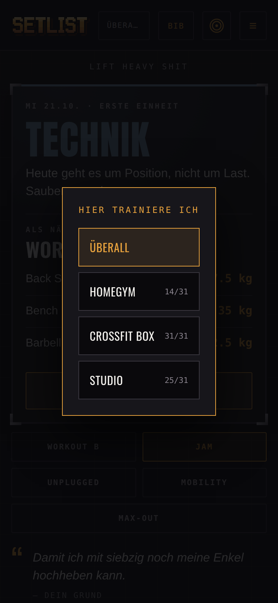
</p>

<p align="center"><sub>Die Ortswahl aus der Kopfzeile — mit der Zahl der hier möglichen Jam-Bewegungen.</sub></p>

## Zwei Entscheidungen, die tragen

**`state.json` ist abgeleitet, nicht gepflegt.** Eine Projektion aus `config.json` und allen Dateien in `einheiten/`. Ein vertippter Eintrag wird nie zum Problem: Datei korrigieren, „state.json neu berechnen", fertig. Arbeitsgewichte werden nie direkt gesetzt — dafür gibt es den Log-Typ `anpassung`.

**„Mindestens" ist nicht „Maximum".** e1RM-Formeln setzen Nähe zum Versagen voraus; ein 5×5-Arbeitssatz ist submaximal, die Formel unterschätzt dort systematisch. Deshalb mischt die Verlaufskurve die Quellen nicht: gestrichelte Linie für Untergrenzen, Max-Outs als eigene Punkte.

---

##  Selbst einrichten

**Nur ausprobieren oder einfach benutzen?** Dann brauchst du nichts davon: App öffnen,
*Lokal starten* (siehe *Loslegen* oben und [Daten](#daten)). Ein eigenes Datenrepo (Schritte 2,
4 und 5 mit der gehosteten App unter [cyphomat.github.io/setlist](https://cyphomat.github.io/setlist/))
lohnt sich, wenn du denselben Stand auf mehreren Geräten willst. Fork und Pages (Schritte 1,
3 und 6) brauchst du nur für eine eigene, unabhängige Fassung, deren Code du selbst in der
Hand hast.

Setlist ist für genau eine Person gebaut — dich. Es gibt keinen Login mit mehreren Konten; wer die App benutzt, ist der oder die, dessen `setlist-data`-Repo hinterlegt ist. Um eine eigene, unabhängige Instanz zu bekommen, brauchst du ein GitHub-Konto und etwa zehn Minuten.

**1 · App-Code forken**

Fork dieses Repo (`cyphomat/setlist`) in dein eigenes GitHub-Konto. Das ist der öffentliche Teil — Code, kein Personenbezug.

**2 · Eigenes Datenrepo anlegen**

Leg ein **privates** Repo namens `setlist-data` an. Mehr braucht es nicht — **keine Datei
von Hand**. Beim ersten Öffnen merkt die App, dass noch kein Programm da ist, und fragt
dich durch: Stangengewicht, die fünf Übungen mit Startgewicht (oder ein Klick auf „mit der
leeren Stange anfangen"), Krafttage, optional Radtage. Daraus schreibt sie eine gültige
`config.json` in dein Repo.

<p align="center">
  
</p>

Wer lieber selbst schreibt, kann das weiterhin — die Datei sieht dann so aus:

```json
{
  "bar": 20,
  "rounding": 2.5,
  "deload": { "afterFails": 3, "factor": 0.9 },
  "lifts": {
    "squat":    { "name": "Back Squat",   "increment": 2.5, "start": 40 },
    "bench":    { "name": "Bench Press",  "increment": 2.5, "start": 30 },
    "row":      { "name": "Barbell Row",  "increment": 2.5, "start": 30 },
    "ohp":      { "name": "Strict Press", "increment": 2.5, "start": 20 },
    "deadlift": { "name": "Deadlift",     "increment": 5.0, "start": 50 }
  },
  "workouts": {
    "A": [{ "lift": "squat", "sets": 5, "reps": 5 }, { "lift": "bench", "sets": 5, "reps": 5 }, { "lift": "row", "sets": 5, "reps": 5 }],
    "B": [{ "lift": "squat", "sets": 5, "reps": 5 }, { "lift": "ohp", "sets": 5, "reps": 5 }, { "lift": "deadlift", "sets": 1, "reps": 5 }]
  },
  "firstWorkout": "A",
  "rest": { "normal": 90, "afterFail": 180 },
  "plates": [25, 20, 15, 10, 5, 2.5, 1.25],
  "week": { "slots": [{ "day": 1, "type": "strength" }, { "day": 4, "type": "strength" }] }
}
```

`start` ist dein Einstiegsgewicht je Übung, `increment` die Steigerung pro erfolgreicher
Einheit. `week.slots` legt fest, an welchen Wochentagen etwas ansteht (`day`: 1 = Montag …
7 = Sonntag); Radslots (`"type": "ride"`) brauchen zusätzlich ein `rides`-Array. Fehlt
etwas davon, bleibt die Wochenübersicht einfach leer — der Rest der App läuft weiter.

`state.json` **nicht** anlegen — die App leitet den Startzustand beim ersten Mal selbst aus
`config.json` ab und schreibt ihn erst nach der ersten abgeschlossenen Einheit zurück.
`einheiten/` als Ordner reicht leer. Optional sind `stimme.json` (eigene Sprüche, siehe
`js/content.js` für die Struktur) sowie `records` und `ziele` in `config.json`, wenn du
Meilensteine oder alte Bestleistungen willst. Den Ordner `soundcheck/` legt der erste
Wochen-Soundcheck selbst an.

**3 · Veröffentlichen**

Im Fork unter **Settings → Pages**: Source auf den `main`-Branch stellen. Nach ein bis zwei Minuten läuft die App unter `https://<du>.github.io/setlist/`.

**4 · GitHub-Token erzeugen**

Klick oben rechts auf dein **Profilbild → Settings** — deine persönlichen Kontoeinstellungen, **nicht** die Settings des Repos — dann **Developer settings → Personal access tokens → Fine-grained tokens → Generate new token.** Zugriff nur auf dein Datenrepo, Permission **Contents → Read and write**, sonst nichts. Setz eine **Laufzeit** (etwa ein Jahr) und erzeug vor Ablauf einen neuen Token — eintragen unter *Tour → ⚙ Backstage → Verbindungen*. Meldet die App „Token ungültig, abgelaufen …“, ist es meist genau das.

Beim ersten Öffnen landest du automatisch auf dem Setup-Screen. Dort trägst du deinen **GitHub-Nutzernamen**, den **Namen deines Datenrepos** (steht schon auf `setlist-data` vor) und den Token ein — kein Code-Editieren nötig, das Repo-Ziel ist direkt in der App einstellbar. Alle drei bleiben ausschließlich im `localStorage` deines Browsers.

**5 · intervals.icu — optional**

Nur nötig, wenn du auch Radeinheiten/Form/HRV/Schlaf willst. Key liegt unter **Settings → Developer** in deinem intervals.icu-Konto.

**6 · Updates holen**

Dein Fork bleibt stehen, wo du ihn abgezweigt hast — am Original wird weitergearbeitet,
aber davon bekommt er von sich aus nichts mit. Die App sagt dir deshalb Bescheid: läuft
dein Fork auf einem älteren Stand, erscheint beim Start einmalig ein Hinweis, und unter
*Backstage → App* steht, welche Version oben liegt und welche bei dir.

<p align="center">
  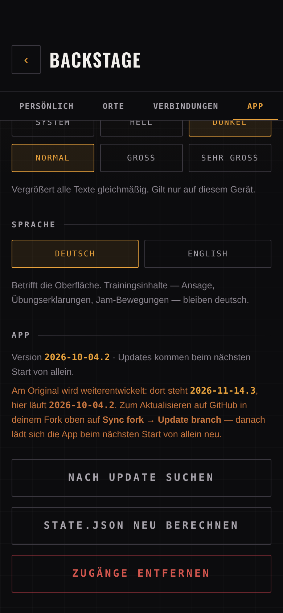
</p>

Aktualisieren geht dann in zwei Klicks auf GitHub:

1. Dein Fork → oben der Hinweis **This branch is N commits behind** → **Sync fork**
2. **Update branch**

GitHub Pages baut danach neu, und beim nächsten Öffnen lädt sich die App einmal selbst
neu. Deine Daten sind davon nicht berührt — die liegen in deinem eigenen `setlist-data`,
das mit dem App-Code nichts zu tun hat.

Falls du eigene Änderungen am Code gemacht hast, geht es über die Kommandozeile:

```sh
git remote add upstream https://github.com/cyphomat/setlist.git   # einmalig
git fetch upstream && git merge upstream/main
git push
```

Fertig. Die erste Einheit legt `state.json` automatisch an; alles danach ist Ableitung, kein manuelles Pflegen.

---

## Daten

**Ohne Konto liegt alles auf dem Gerät.** Wer mit *Lokal starten* beginnt, hat Programm,
Einheiten, Soundchecks und Notizen in diesem Browser (IndexedDB). Es gibt kein Konto und keinen
Server, und nichts verlässt das Gerät, außer du verbindest intervals.icu. Die App bittet
den Browser, den Speicher dauerhaft zu halten. Auf dem iPhone gilt das aber nur für die
installierte App: Safari räumt den Speicher normaler Webseiten nach sieben Tagen ohne Besuch
auf. Also *Zum Home-Bildschirm*.

**Sichern und Einlesen.** Unter *Backstage → App → Daten* lädst du eine Sicherung als
JSON-Datei herunter (`setlist-sicherung-JJJJ-MM-TT.json`) und liest sie auf einem anderen
Gerät oder nach dem Löschen wieder ein. Einlesen **legt dazu, statt zu ersetzen**:
Einheiten sind unveränderlich, also ist die Vereinigung beider Seiten richtig. Dieselbe
Einheit kommt nicht doppelt, und vorher zeigt die App, wie viel neu ist. Ein anderes
Programm in der Datei wird nur nach Rückfrage übernommen. Der Zustand (Arbeitsgewichte,
A/B) wird danach aus allen Einheiten neu berechnet. Haben sich seit der letzten Sicherung
Einheiten angesammelt und liegt sie zwei Wochen zurück, erinnert der Wochenkopf daran.

**Oder mit eigenem GitHub-Datenrepo.** Wer Setlist auf mehreren Geräten mit demselben
Stand nutzen will, verbindet im Setup ein privates Repo (siehe
[Selbst einrichten](#-selbst-einrichten)). Dann liegt jede Einheit als Datei im Repo. Wer so
angefangen hat und lieber ohne Konto weitermacht: *Daten → Aufs Gerät umziehen* holt alles
aus dem Repo auf dieses Gerät und trennt GitHub. Im Repo bleibt alles liegen. Ein Abgleich
in beide Richtungen wie bei Riffforge folgt.

**Löschen heißt löschen.** Im lokalen Modus heißt der Knopf *Alles löschen*. Er nennt die
Zahl der Einheiten, und ohne Sicherung ist danach nichts mehr da.

---

##  Sicherheit und Datenschutz

Die App ist für eine Person gebaut und soll auch nur für diese Person sichtbar sein.
Was das konkret heißt:

**Deine Daten liegen auf deinem Gerät oder in deinem privaten Repo.** Lokal bleibt alles in
der IndexedDB dieses Browsers. Sie ist an die Adresse gebunden; unter `cyphomat.github.io`
teilen sich allerdings alle Seiten dieses Kontos denselben Speicherbereich. Mit Datenrepo
liest und schreibt die App ausschließlich in `setlist-data` — Einheiten, Körpergewicht, Notizen, der Injury Report (also Gesundheitsangaben) und die Namen deiner Studios. Der App-Code selbst (dieses Repo)
ist öffentlich, enthält aber keine Daten. Beim Start prüft die App die Sichtbarkeit deines
Datenrepos und **warnt unübersehbar, wenn es öffentlich steht** — sonst würde man es nie
merken, weil die App genauso funktioniert.

**Zugangsdaten verlassen den Browser nur zu ihrem eigenen Dienst.** GitHub-Token und
intervals.icu-Key liegen im `localStorage` und werden ausschließlich als
`Authorization`-Header mitgeschickt — nie in einer Adresse, nie in einem Commit, nie in
einer Fehlermeldung.

**Drei externe Ziele, sonst keine.** `api.github.com` für deine Daten (nur mit Datenrepo), `intervals.icu` für
Rad und Form, ein YouTube-*Suchlink* in der Bibliothek (ohne Referrer). Keine Analytics,
kein CDN, keine Schriften von fremden Servern.

**Abmelden räumt das Gerät leer.** Lokal heißt der Knopf *Alles löschen* (siehe [Daten](#daten)). Mit Datenrepo löscht *Backstage → App → Zugänge entfernen* löscht Token, Key **und** alle zwischengespeicherten Daten aus dem Browser — Einheiten, Injury Report, Gewicht, Schlaf, Fahrten. Es bleiben nur Einstellungen wie Thema und Schriftgröße. Liegen noch ungesendete Einheiten in der Warteschlange, sagt die Rückfrage das vorher.

**Nicht in fremden Seiten.** Lädt eine andere Adresse die App in einem Rahmen, zeigt sie nur einen Hinweis und startet nicht — so lassen sich keine Klicks unterschieben. Auf GitHub Pages geht das nicht per Header, deshalb erledigt es `js/boot.js` vor dem ersten Bild.

**Fremdtext wird maskiert.** Aktivitätsnamen aus intervals.icu setzt nicht du, sondern
Strava, Zwift oder eine Gruppenfahrt. Solcher Text — und genauso alles aus deiner `config.json` — wird vor der Anzeige maskiert
(`js/sicher.js`), und eine strikte Content-Security-Policy (`script-src 'self'`) fängt ab,
was durchrutschen sollte. Selbst eingetragene Videolinks werden auf `http`/`https`
begrenzt.

**Was bewusst nach draußen geht:** Ist die Übertragung nach intervals.icu aktiv, landen
dort Datum, Dauer, geschätzte Trainingslast und eine Zeile pro Übung mit Gewicht und
Wiederholungen. Abschaltbar unter *Backstage → Verbindungen*.

---

##  Aufbau

| Datei | Rolle |
|---|---|
| `js/program.js` | 5×5-Automat, Plattenrechner, e1RM. Reine Funktionen. |
| `js/coach.js` | Ansage, Ton, Meilensteine, Minierfolge. Ebenfalls rein. |
| `js/wod.js` | Jam-Generator, deterministisch über einen Seed. |
| `js/stats.js` | Tonnage, Bestwerte, Sparklines, Radstatistik. |
| `js/content.js` | Wissensschicht: Cues, Soundcheck, Technik, Encore, Stimme. |
| `js/bibliothek.js` | Bündelt alle Übungen zu einer durchsuchbaren Liste. |
| `js/i18n.js` | Oberflächentexte auf Deutsch und Englisch. |
| `js/geraete.js` | Orte, Ausstattung, Machbarkeit einer Bewegung. |
| `js/sicher.js` | Maskiert Fremdtext, prüft Adressen. |
| `js/aktualisierung.js` | Vergleicht die eigene Version mit der des Originals; Autor, Issues und Quelltext-Link (im Fork der Fork). |
| `js/einrichten.js` | Baut aus ein paar Antworten eine gültige `config.json`. |
| `js/persoenlich.js` | Grund, eigene Zeilen und alte Bestleistungen. |
| `js/unplugged.js` | Körpergewichts-Intervalle, Vorrat und Ablauf. |
| `js/verletzung.js` | Injury Report: Sperren, Verlauf, Pausenfenster für die Serie. |
| `js/merch.js` | Merch-Stand: Aufnäher, Schallplatten, Rang, Tourshirts, Wochenregler — alles aus den Logs. |
| `js/hilfs.js` | Aftershow: Hilfsübungen bereinigen, letztes Mal, Bilanz. |
| `js/wach.js` | Hält den Bildschirm während des Trainings an. |
| `js/export.js` | Einheiten als CSV, sicher gegen Formeln. |
| `js/feuer.js` | Pixelfeuer (Doom-Algorithmus, eigene Umsetzung). |
| `js/ansager.js` | Entscheidet, was nach der Einheit angesagt wird. |
| `js/soundcheck.js` | Wochen-Soundcheck: Kalenderwochen, Fälligkeit, Serie, Bereinigen der Eingaben. |
| `js/boot.js` | Thema, Speicherumzug und Einbett-Sperre vor dem ersten Bild. |
| `js/store.js` | Datenspeicher: lokal im Browser oder im GitHub-Repo, dieselben Pfade; Offline-Puffer. |
| `js/lokal.js` | Die lokale Ablage: Dateien in IndexedDB. |
| `js/sicherung.js` | Sichern und Einlesen als JSON-Datei, Vereinigung statt Ersetzen. |
| `js/intervals.js` | Liest Fahrten und Form; schreibt Krafteinheiten zurück. |
| `js/app.js` | Oberfläche und Ablauf. |
| `sw.js` | Cacht die App-Hülle. Trainingsdaten bewusst **nicht**. |
| `tools/tests.mjs` | Führt alle Tests mit Node aus; dasselbe tut die GitHub Action bei jedem Push. |
| `tools/proben.mjs` | Browserproben: die echte App im Chromium, mit gestellter GitHub-API (optional, Playwright). |
| `tools/pixel.mjs` | Baut alle Pixel-Grafiken: die Bögen in `assets/pixel/` (aus den Quellbildern in `tools/pixel/`), Schriftzug und App-Icons (`icons/`) und die README-Bilder (`assets/readme/`); `--pruefe` läuft in der Action. |

---

##  Tests

```sh
node tools/tests.mjs
```

Mit Node 22 oder neuer (empfohlen: die aktuelle LTS), ohne Installation. Dasselbe läuft
als GitHub Action bei jedem Push und Pull Request (`.github/workflows/tests.yml`); die
Actions sind an Commits gepinnt, neue Versionen meldet Dependabot als Pull Request. Ohne Node geht es auch mit der
JS-Engine, die in macOS ohnehin steckt:

```sh
JSC=/System/Library/Frameworks/JavaScriptCore.framework/Versions/A/Helpers/jsc
for t in tests/*.test.js; do $JSC --module-file=$t; done
```

1861 Tests in 26 Dateien. Kein Build, keine Abhängigkeiten.

### Browserproben (optional)

Die Tests prüfen die Rechnung, die Proben das, was man sieht. Sie öffnen die echte App
in Chromium, mit gestellter GitHub-API, gestelltem intervals.icu und einem festen Datum:

```sh
node tools/proben.mjs                 # alle: start, einheit, tour, merch, buehne, bibliothek, rueckschau, lokal, sicherheit, englisch, ueber
node tools/proben.mjs start merch     # einzelne
node tools/proben.mjs -v              # auch jede bestandene Prüfung
```

Geprüft wird in beiden Themen, mit „Sehr groß“, bei 360 bis 1280 px und auf Deutsch und
Englisch: Was zu sehen sein muss, ist da, nichts ragt über den Rand, und es gibt keine
Seitenfehler. Dazu kommen Sicherheitsfälle: Eigener Text läuft nie als Code, Abmelden
räumt auf, und die App lässt sich nicht in fremde Seiten einbetten.

Einen Server bringen die Proben selbst mit. Sie brauchen nur Playwright samt Chromium
(`npx playwright install chromium`; ein eigener Browser geht über `CHROMIUM=/pfad`). Die
Bilder landen im Temp-Ordner (`PROBEN_BILDER` ändert das). In der GitHub Action laufen
sie bewusst nicht, damit Setlist ohne Abhängigkeiten bleibt.

---

## Veröffentlichen

```sh
sh tools/release.sh 2026-09-14.1
git add -A && git commit -m "…" && git push
```

Setzt `version.json` und den Cache-Namen in `sw.js` gemeinsam — beides muss sich ändern, sonst merkt die App nichts Neues.

Screenshots neu aufnehmen — zwei Werkzeuge, weil zwei Sorten Bildschirm:

```sh
python3 -m http.server 8765 &

sh tools/screens.sh        # Training: Start, Einheit, Tour, Jam, Max-Out
node tools/shots.mjs       # Einrichten, Stimme, Orte, Fork-Hinweis
```

`screens.sh` treibt `tools/shot.html` mit Chrome — die App läuft dort aus dem
Zwischenspeicher. Das reicht nicht für Bildschirme, die davon abhängen, was die API
*antwortet*: der Einrichte-Bildschirm erscheint nur bei einer fehlenden `config.json`, der
Fork-Hinweis nur bei einer neueren Version im Original. `shots.mjs` antwortet deshalb
selbst (Playwright, plattformunabhängig, `npx playwright install chromium`).

---

## Auf dem Mac

Web-App, die URL genügt. Für ein eigenes Fenster: **Safari** → Ablage → *Zum Dock hinzufügen*, oder **Chrome** → Adressleiste → *Installieren*.

Token und Key liegen im `localStorage`, also pro Gerät — auf dem Mac einmal neu eintragen. Die Trainingsdaten kommen aus dem Repo und sind überall dieselben. Zwei Geräte gleichzeitig eine Einheit abschließen lassen sollte man nicht; nacheinander ist problemlos.

## Zugangsdaten

Nirgends im Code, nirgends im Repo, in keinem Commit. GitHub-Token und intervals.icu-Key werden in der App eingegeben und liegen ausschließlich im `localStorage` des jeweiligen Browsers.

---

##  Mitmachen

Setlist ist von [@cyphomat](https://github.com/cyphomat).

- **Fehler gefunden oder einen Wunsch?** Gern als [Issue](https://github.com/cyphomat/setlist/issues) hier im Original-Repo.
- **Forken und anpassen ist ausdrücklich erwünscht.** Der Quelltext steht unter der [MIT-Lizenz](LICENSE): verwenden, ändern, weitergeben, auch in einer eigenen Fassung. Wie du deine eigene Instanz aufsetzt, steht unter [Selbst einrichten](#-selbst-einrichten).
- **Im Fork** zeigt der Quelltext-Link der App (*Backstage → App → Über Setlist*) auf deinen Fork. Feedback geht weiterhin hierher ans Original.
- **Ohne Gewähr:** Setlist rechnet Gewichte, Pausen und Ansagen nach Faustregeln. Sie ersetzt weder Trainer noch Arzt. Was du an die Stange lädst, entscheidest du.
